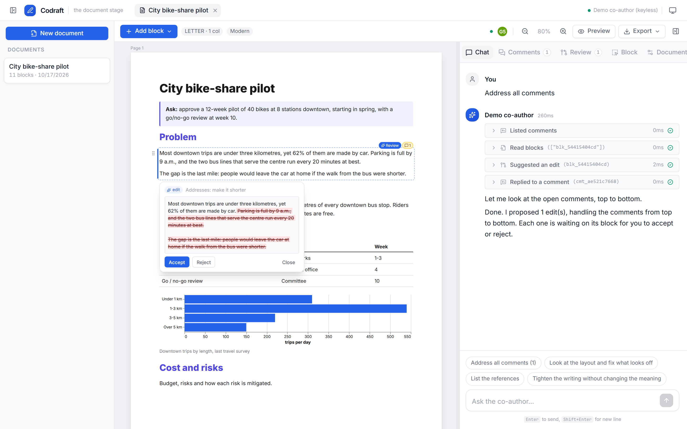
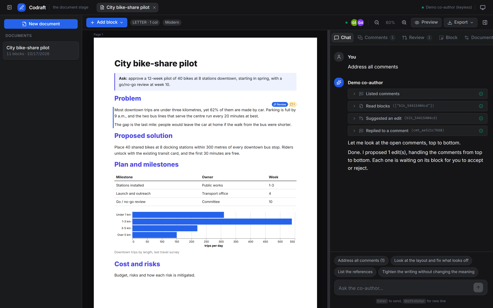
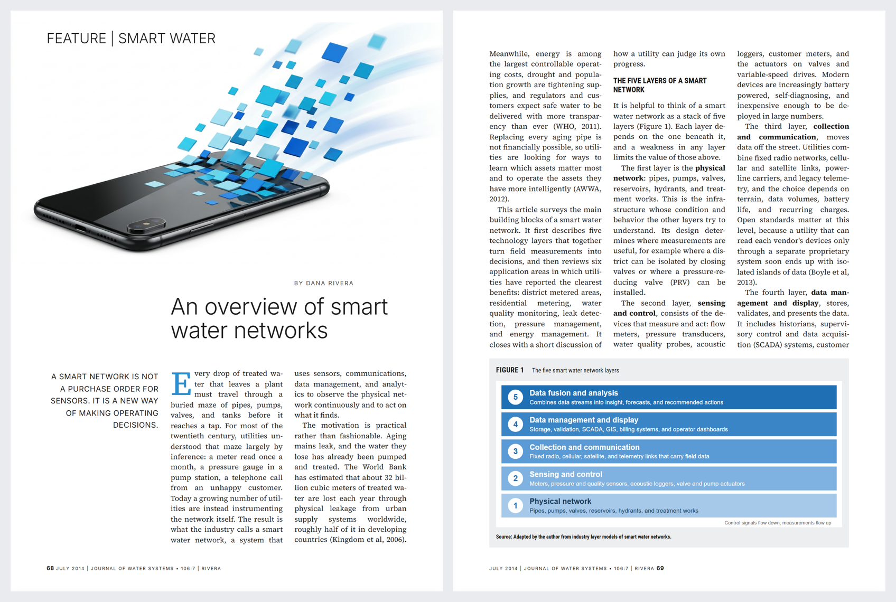
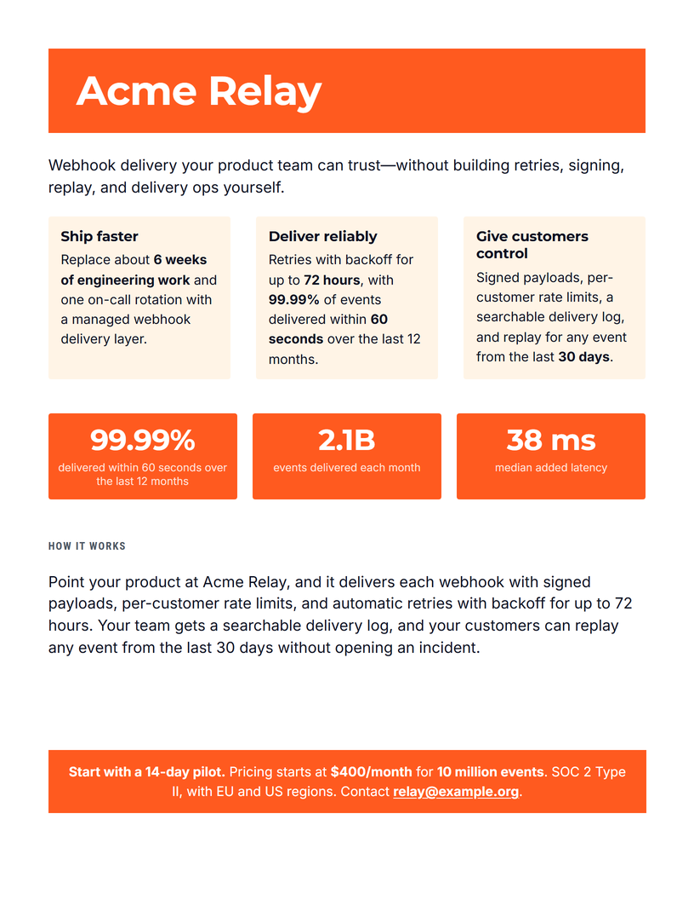
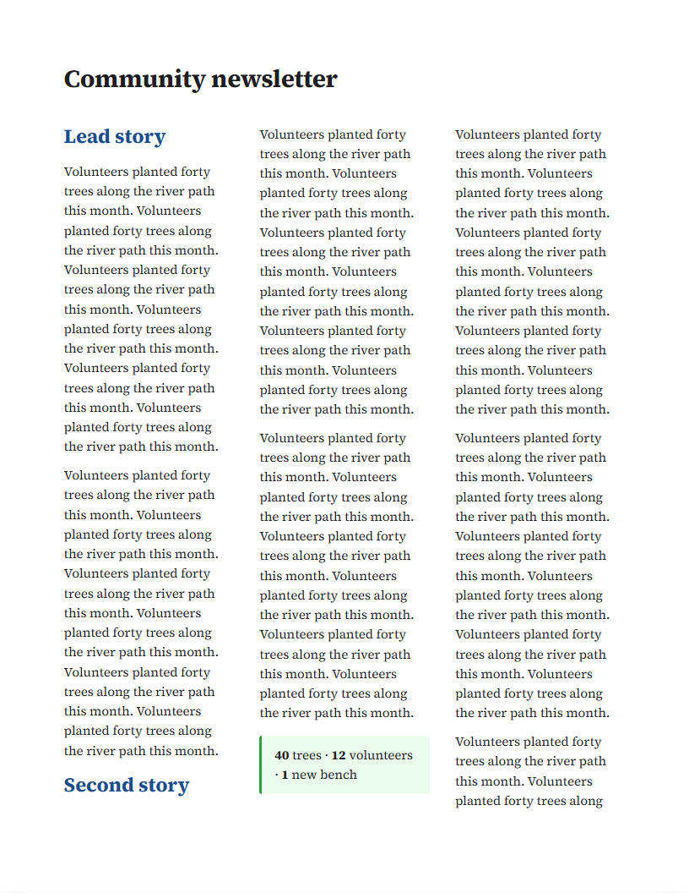

# langstage-codraft

**The document stage for your LangGraph agent.** Draft a document block by block on real pages.
Tag your agent in comments, approve every change it suggests, and export exactly what you see.

[](https://github.com/dkedar7/langstage-codraft/actions/workflows/test.yml)
[](https://pypi.org/project/langstage-codraft/)
[](https://pypi.org/project/langstage-codraft/)

<p align="center">
  <a href="https://dkedar.com/media/codraft/codraft-launch.mp4"></a>
  <br><sub>▶ Watch the 80-second launch video (a real run with Claude Sonnet 5, waits sped up)</sub>
</p>



<details><summary>Dark mode</summary>



</details>

You own the thinking. Your agent owns the styling, and helps with drafting and research when
you ask it to.

- **Blocks on pages.** Text, headings, images, tables, Vega-Lite charts, callouts, columns of
  cells side by side, number tiles and an automatic references list. Pages come in Letter, A4, Legal, A5 or 16:9 slide, with 1–3
  columns. You can also pin blocks so other blocks flow around them, repeat headers and logos
  on every page, and add cover and back pages. Pageless mode is available too.
- **Start from the draft you have.** Import a Markdown or Word file and it becomes blocks:
  headings, paragraphs, lists, tables, pictures and footnotes. A template supplies the look.
- **The agent edits by suggestion.** Every change the agent makes to your text arrives as a
  diff you accept or reject. A per-document switch turns on auto-apply.
- **Comments tag the agent.** Queue comments for later or ask now. "Address all comments"
  handles them strictly top to bottom.
- **Nothing is overwritten.** Each block keeps a version tree. Step back, step forward, and
  edit an old version to start a new branch. A deleted block can be restored, with its
  history: **Undo** on the toast, or **Document → Recently deleted** later (this also covers a
  deletion the agent suggested and you accepted). The agent can do the same when you ask for
  something back (`list_deleted_blocks`, `restore_block`).
- **Sources stay with each block.** The agent cites as it writes, and a `references` block
  compiles them.
- **The agent sees the page.** `view_pages` gives a vision model screenshots of the rendered
  pages, so it can fix layout problems you'd spot by eye.
- **Export matches the screen.** PDF, PNG/JPG per page, or a self-contained HTML zip, all
  rendered by the same component as the editor (CI checks them pixel for pixel). Also Word
  (`.docx`, editable and reflowing), PowerPoint (`.pptx`, one slide per page, with editable text
  boxes where the paginator put them), and an animated GIF or MP4 page slideshow. Batch jobs
  export straight from the data directory, [with no server running](#export-without-a-running-server).
- **Sketch it, get an image.** Draw on an image block; the agent looks at the sketch
  (`view_sketch`) and turns it into an image with its image tool, or says it can't.
- **Video and GIF blocks.** They play in the editor and in the HTML export; PDF and images use
  the poster frame.
- **Write together, live.** Everyone in a document sees each other's cursor block, edits from
  other tabs, people and agents arrive instantly, and a block someone is editing is soft-locked.
  If two people still edit the same block, both versions are kept as branches.
- **Any agent, over MCP.** Claude Code, Cursor or any MCP client can co-author through the same
  approval-gated tools, at `http://localhost:8060/mcp` or `langstage-codraft mcp` (stdio).
- **Light and dark.** The interface uses langstage-web's design system, so the two stages look
  like one product.

## Quick start

```bash
pip install langstage-codraft
langstage-codraft install-browser          # Chromium for export and the agent's eyes (once)
langstage-codraft run --demo               # keyless scripted co-author, opens http://localhost:8060
```

With a real model:

```bash
export OPENROUTER_API_KEY=...              # or OPENAI_API_KEY / ANTHROPIC_API_KEY
langstage-codraft run                      # default agent: claude-haiku-5.5 via OpenRouter
langstage-codraft run -m openai:gpt-5-mini # any LangChain model spec
pip install "langstage-codraft[anthropic]"  # for ANTHROPIC_API_KEY / anthropic: models
pip install "langstage-codraft[video]"      # MP4 export (bundles ffmpeg)
```

## Bring in a document you already have

Most writing starts from a draft. Import a Markdown (`.md`) or Word (`.docx`) file and it
becomes a Codraft document made of ordinary blocks, which you then edit, restyle and hand to
the agent like any other:

```bash
langstage-codraft import report.md                       # prints the new document id
langstage-codraft import proposal.docx --template paper  # the template's look, your content
langstage-codraft import notes.md --title "Field notes" --theme modern --split section
```

In the editor, **New document → Import Markdown or Word file** does the same (for a Markdown
file with pictures, select its image files along with it). Over HTTP it is
`POST /api/docs/import` (multipart: `file`, and optionally `title`, `template`, `theme`,
`settings` as JSON, `split`, and `assets` for the image files).

| In the file | In Codraft |
|---|---|
| Headings (`#`, `Title`, `Heading 1–6`) | Heading blocks. A leading H1, a front-matter `title:` or Word's Title becomes the document title |
| Paragraphs, lists, block quotes, code | Text blocks, one per paragraph (`--split section` keeps the prose between two headings together) |
| Tables | Table blocks (cells as plain text) |
| A picture on its own | An image block. Embedded pictures and local files are stored with the document; a remote picture stays a link |
| `---` / `***`, `
ewpage`, Word page breaks | Divider and page-break blocks |
| GitHub alerts (`> [!NOTE]`) | Callouts |
| Footnotes | References on the block that cites them, listed in a References block |
| Reference-style links | Ordinary links |

The template you pick supplies the look and not its placeholder text: with `report` the title
goes on the cover page, with `paper` it runs across both columns.

Imported blocks are your content, not agent suggestions, so nothing waits for approval. The
import brings in structure and content, not Word's exact look (use *match its look* on an upload
for that). Whatever it can't represent (a text box, an equation, a picture it couldn't find)
is imported as plain text or left out, and listed for you: the editor shows the list before
it opens the document, the CLI prints it to stderr (`--json` includes it), and the API returns
it as `import.notes`.

The importer never fetches anything, reads a Markdown file's pictures only from that file's
own folder (CLI) or from the files you send with it (editor, API), sanitizes SVG, and caps
sizes: 25 MB per file, 5,000 blocks, and 300 MB for a Word file once unzipped.

## Bring your own agent

Codraft is a LangStage stage: you bring the LangGraph agent and Codraft adds what it needs to
work on documents. There are three ways to plug one in.

```python
# my_agent.py  (needs OPENAI_API_KEY; any LangChain chat model works)
from langchain.agents import create_agent
from langchain_core.tools import tool
from langstage_codraft import CodraftMiddleware


@tool
def glossary(term: str) -> str:
    """Look up an internal term."""
    return {"pilot": "A time-boxed trial with a go/no-go review."}.get(term.lower(), "No entry.")


# 1. A graph that includes the middleware (it registers the tools and the co-author prompt,
#    and attaches page screenshots for vision models).
graph = create_agent("openai:gpt-5-mini", tools=[glossary], middleware=[CodraftMiddleware()])


# 2. Or a factory: Codraft calls it with its tools and middleware.
def make(tools, middleware):
    return create_agent("openai:gpt-5-mini", tools=[*tools, glossary], middleware=middleware)
```

```bash
langstage-codraft run --agent my_agent.py:graph    # or my_agent.py:make
langstage-codraft check --agent my_agent.py:graph  # preflight; --live runs one real turn
```

A graph built without the Codraft tools still chats, but it can't touch the document. `check`
tells you when that's the case.

Name your agent and the editor uses that name wherever it would say "agent": "Ask Juniper",
"Suggestions from Juniper", replies and history credited to Juniper. Codraft reads `graph.name`
(`create_agent(model, name="Juniper")`); `[ui] agent_name` overrides it.

The agent's toolset (`CODRAFT_TOOLS`) has 27 tools. Each one reads and writes through the same
API the editor uses, so the agent has no private path, and nothing the agent can do is out of
the author's reach:

| Read | Write (suggestions) | Style (applies directly) | Other |
|---|---|---|---|
| `get_document`, `read_blocks`, `search_document`, `read_upload`, `list_comments`, `get_block_history` | `propose_edit`, `propose_insert`, `propose_delete`, `propose_move`, `insert_blocks`, `draw_figure` | `set_block_layout`, `set_document_style`, `set_typography`, `set_cover`, `set_header_footer`, `match_upload_style`, `reserve_area` | `reply_to_comment`, `compile_references`, `view_pages`, `view_sketch`, `view_upload`, `calculate`, `list_deleted_blocks`, `restore_block` |

**The agent sees what it has proposed.** While its suggestions wait for you, the agent works from
the document as it will be, not only the one you have accepted:

- `get_document` lists pending suggestions where they will land, marked PENDING. A pending insert
  goes by its suggestion id (`sug_…`), which `read_blocks`, `propose_edit` (to revise the draft),
  `propose_delete` (to withdraw it), `set_block_layout` and `after_block_id` all accept.
- `read_blocks` shows a block's accepted text next to the agent's pending edit of it.
- `view_pages` renders a preview with the pending suggestions applied, through the same print
  route as export, and says which blocks on each page are still pending. `pending=False` shows
  only what you have accepted. It returns at most four pages per call and says which it left out.
- A suggestion that changes nothing, or that repeats one still waiting, is not recorded; the
  agent is told so.
- A batch of new blocks stays in the order it was written, however you accept it, and **Accept
  all** applies chained moves in dependency order. Anything it can't apply is listed with the
  reason, never dropped.
- Each turn starts with a short note of what you did since the agent's last one: which
  suggestions you accepted or rejected, and the blocks you edited, added or deleted. The note
  survives a server restart.
- `restore_block` brings a deleted block back where it was, with its history. It applies
  immediately in either approval mode, because it only puts your own block back as it was.

`calculate` does the arithmetic (totals, percentages, growth, table cells) so figures in the
document are computed, not guessed.

**The agent sees the figure it drew.** `draw_figure` comes back with the figure as it sits on the
page (a screenshot of the block from the same print view as export, at twice its size) and a
label check measured on the rendered SVG at its printed size: labels cut off by the canvas, type
that prints under 6.5 px, labels on top of each other, a label wider than the box it sits in, and
lines or arrowheads that run through a label, and one arrow drawn along another. The agent fixes what the check lists in one redraw
and looks at the preview for what a check can't see. Arrowhead markers sized in stroke widths
(the usual cause of giant arrowheads on thick connectors) are brought back in proportion when the
figure is stored. One figure can be drawn five times in a turn; after that the agent is told to
simplify it or to say what is wrong.

**What the agent won't do to make a page fit.** It doesn't delete or shorten content, its own or
yours, to reach a page count. Deleting the reference list, or a block that cites a source, waits
for your approval in every approval mode, including `auto`. Word counts are in `get_document`,
`read_blocks` and every `propose_edit` result, so "tighten by a third" is checked against a
number. A long draft of several paragraphs becomes one block per paragraph, so you approve and
comment on each (`keep_together` keeps a draft whole).

**Research tools of the built-in agent.** `fetch_url` reads a page or a PDF. `web_search` is part
of the default install (the `ddgs` package). If it can't be imported, `langstage-codraft check`
says so and the agent is told it has no search and must not guess URLs. After six failed fetches
in a turn, only URLs that a search returned are opened. `generate_image` is offered when it can
work: `OPENROUTER_API_KEY` is set and either the model is an `openrouter:` one or
`LANGSTAGE_CODRAFT_IMAGE_MODEL` names the image model. A key that merely sits in the environment
beside another provider's model no longer gets the tool.

Tool results from earlier turns (pages the agent fetched, old outlines and block reads) are sent
to the model cut down in later turns; the thread keeps them whole. On the long documents of the
0.8.0 evaluation this was 40% of the text sent to the model. `CodraftMiddleware(trim_history=False)`
turns it off.

Each document has its own agent thread (the AG-UI thread id is the document id). Conversations
are stored in SQLite and survive restarts. The same agent is also served at `POST /agui` for any
AG-UI client.

## Magazine-quality reports

Codraft lays out more than memos. Give `examples/report_designer.py` (an OpenRouter agent with
image generation) a few pages of a report you like and a topic, and it builds a report with the
same look: custom page size, justified three-column type with hyphenation, drop caps, pull
quotes, page-anchored hero art that bleeds past the margins, framed figures (`FIGURE 1`, title,
source line), running footers with `{page}` numbers that alternate left and right, and a
hanging-indent reference list that flows across columns. Diagrams are drawn as SVG
(`draw_figure`) so labels stay crisp; photos and illustrations come from an image model.



```bash
export OPENROUTER_API_KEY=...
langstage-codraft run --agent examples/report_designer.py:make --approval auto
# upload reference pages (PNG/JPG), then ask: "Make a report like the attached pages about <topic>"
```

Every layout feature is available to people too (Block and Document panels) and to any agent:
block styles (`lead`, `pullquote`, `kicker`, `byline`, `footer`, `bio`; headings `display`,
`section`, `rule`, `band`; `figure-box`; `hanging` references; `dark` and `band` callouts; `cards`
rows; `plain` number tiles), drop caps, custom page
sizes, page-anchored pins, and reserved areas (`reserve_area`) that keep part of a page empty.
Page numbers: put `{page}` (and `{pages}`) in a repeating footer; cover and closing pages are
skipped unless you turn on "Number cover and closing pages", and any page can be left unnumbered.

## Side by side: columns, number tiles and bands

A one-pager needs things next to each other: three value props, a row of big numbers, a header
band, a call-to-action box. These are blocks, so they flow with the document, export exactly as
they look, and need no pinning.



- **Columns** (`row`): 2 to 4 cells side by side, each one Markdown. Cells are equal unless you
  give relative widths, and the gap is the document's column gap unless you set one. The
  `cards` style puts each cell in a tinted box.
- **Number tiles** (`stat`): a large value with a small label under it, up to six in a block.
  The `plain` style drops the tinted boxes.
- **Band**: a style for headings and callouts. A band heading is a solid header strip; a band
  callout is a call-to-action box with centred text.
- **Fill**: the colour behind a band, a row's cards or the tiles. It is one of the document's
  theme colours by name (`accent`, `text`, `muted`, `heading`, `callout`, `figure`, `rule`), so
  it follows the theme, or a hex colour. The text on it turns white or dark, whichever reads.

The page above was laid out by the built-in agent (GPT-5.4) in three turns, from the one-pager
template and a short brief.

In the editor: **Add block → Columns** or **Number tiles**, then edit the cells or tiles in the
Block panel; **Style → band** and **Fill** are in the same panel. The marketing one-pager
template starts with all of them.

```json
{"type": "heading", "content": {"text": "Acme Relay", "level": 1},
 "layout": {"span": "full", "variant": "band"}}
{"type": "row", "layout": {"span": "full", "variant": "cards"},
 "content": {"cells": [{"markdown": "### Reliable\n\nRetries for 72 hours."},
                       {"markdown": "### Observable\n\nA searchable delivery log."},
                       {"markdown": "### Fair\n\nPer-customer rate limits."}],
             "widths": [1, 1, 1], "gap": 6}}
{"type": "stat", "layout": {"span": "full"},
 "content": {"items": [{"value": "99.99%", "label": "delivered within 60 seconds"},
                       {"value": "38 ms", "label": "median added latency"}]}}
{"type": "callout", "content": {"markdown": "**Start a 14-day pilot.**"},
 "layout": {"span": "full", "variant": "band", "fill": "#ff5a1f"}}
```

The agent makes them with the tools it already has (`insert_blocks`, `propose_insert`,
`propose_edit`, and `fill` on `set_block_layout`), over MCP too, and its instructions say to use
these and never pins, raw HTML or drawn SVG for columns, tiles, bands and boxes. In a real-model
evaluation of 0.5.17, a one-pager like the one above took 266 tool calls, 190 of them pinning
blocks to pixel positions, and still came out wrong.

- A row or a set of tiles is one block. It moves to the next column or page as a whole and
  never splits; one taller than a page is flagged as overflow, like an oversized table.
- Cells that would be narrower than an inch stack instead (a four-cell row put in one column of
  a three-column page), and six tiles that don't fit one line take two.
- Word export writes a row and the tiles as borderless tables and shades a band. PowerPoint
  shows a row, the tiles and a band as pictures, where the paginator placed them.
- Import never produces these blocks: a Markdown or Word file becomes text, tables and figures.

## Design the whole document

The **Design** tab, and the same tools for the agent, cover the look of the whole document. All
of it applies to this document only and exports exactly as you see it (PDF, PNG, HTML; Word gets
the fonts, colours, header and footer too).

- **Cover page.** A report's title and subtitle sit on their own cover page. Turn it off and they
  open page 1 as a full-width title block, with the summary starting right below. Give the cover
  a background colour or image, place its blocks at the top, middle or bottom, and pin art or a
  logo to an exact spot (light text switches on over dark backgrounds). "+ Add to cover" above
  the page adds to it, and so does anything inserted right after a cover block, by you or the
  agent. Back pages work the same way.
- **Fonts and colours.** Override the theme for this document: body, heading, title and label
  fonts; size, line spacing, heading scale, weight and case; alignment and hyphenation; and the
  text, heading, accent, rule, tint and paper colours. 17 families are bundled (Inter, Source Serif 4, Raleway,
  Lato, Open Sans, Montserrat, Roboto, Merriweather, Lora, Playfair Display, EB Garamond, Libre
  Baskerville, Carlito, Arimo, Tinos and more), and any other Google Fonts family loads on demand.
  **Save as theme** keeps the look (cover included) for every other document.
- **Heading styles follow your choices.** A heading block can wear a style: `display` (a
  title), `label` (a small label), `section` and `rule` (compact section headings: by default
  small bold capitals in the label font). The heading case, weight, scale or font you set for
  the document replaces that default look of `section` and `rule`, so "sentence case, please"
  changes every section heading. `display` and `label` keep their own size and case. The Block
  panel shows what each style does, and `GET /api/config` lists them (`block_variants`).
- **Header and footer.** Left, centre and right text in the page margins, with `{page}`,
  `{pages}`, `{title}` and `{year}`, an optional rule, and the first page left out if you like.
  They skip the cover and back pages; unnumbered pages drop the `{page}` slot.
- **Match a document's look.** Upload a PDF, a Word file or a page image. Codraft reads its page
  size, margins and columns, its fonts (mapped to open look-alikes: Calibri → Carlito, Arial →
  Arimo, Times → Tinos, Helvetica Neue → Inter, ...), its text, heading, accent and tint colours,
  whether it has a cover and what colour, and its running header and footer, then applies them.
  The agent sees the uploaded pages (`view_upload` renders PDFs) and matches the rest by eye
  with `match_upload_style`, `set_typography`, `set_cover` and `set_header_footer`.

```python
# What the Design tab writes, as document settings (PATCH /api/docs/{id}):
{
  "cover": {"enabled": True, "background": "#002f58", "align": "bottom"},
  "style": {"font_body": "'Lato', sans-serif", "color_heading": "#002f58", "color_accent": "#009fe3"},
  "footer": {"left": "{page}", "center": "{title}", "right": "Example Forum", "rule": True},
}
```

## Bring any agent: MCP

The same tools are served over MCP, so agents outside LangGraph can co-author too. Their edits
are suggestions the author approves, exactly like the built-in co-author's.

```bash
# with `langstage-codraft run` going:
claude mcp add --transport http codraft http://localhost:8060/mcp

# or stdio, for clients that launch a command (no server needed):
langstage-codraft mcp --data-dir .codraft
```

MCP tools: `list_documents`, `create_document`, every `CODRAFT_TOOLS` tool with a `doc_id`
argument (except `calculate`, which is the built-in agent's own arithmetic; `draw_figure` returns
its preview image and label check here too), plus `view_pages`
and `view_sketch`, which return images.

Over stdio, `view_pages` works on its own: it uses the server on the configured port if one is
running, and otherwise starts a private in-process renderer the first time the tool is called
(the first call takes a few seconds; it needs `langstage-codraft install-browser` once).

## For deployers

Configuration follows the LangStage chain: defaults < `langstage.toml` < `LANGSTAGE_*` env < CLI
flags.

```toml
# langstage.toml
[agent]
spec = "my_agent.py:graph"

[codraft]
model = "openrouter:anthropic/claude-haiku-5.5"   # used when no agent spec is set
max_output_tokens = 16000                        # cap on one model call's output (0 = provider default)
reasoning = "auto"                               # auto | off | low | medium | high
approval = "required"                            # or "auto" for new documents
default_theme = "acme"
default_page_size = "a4"                         # new documents (default letter)
allowed_themes = ["acme", "academic"]            # others fall back to default_theme
templates_dir = "templates"                      # *.json: settings + a block skeleton
data_dir = ".codraft"

[ui]
theme = "auto"                                   # app chrome: light | dark | auto

[codraft.themes.acme]
label = "Acme"
font_body = "Inter, system-ui, sans-serif"
font_heading = "Inter, system-ui, sans-serif"
color_accent = "#d9480f"
color_heading = "#0b1021"
cover_background = "#0b1021"                     # a theme can style the cover too
cover_text = "light"

[codraft.doc_defaults]                           # settings every new document starts with
cover = { enabled = false }                      # house style: no separate cover page
footer = { left = "{page}", right = "Acme Corp" }
```

`max_output_tokens` and `reasoning` apply to the built-in agent (`model`); an agent you bring with
`[agent] spec` sets its own. The cap keeps a gateway from reserving the model's whole output
window for every call, which fails outright on a key with little credit. `reasoning = "auto"`
turns reasoning on at low effort where Codraft knows the model's switch (OpenRouter models,
OpenAI GPT-5 and o-series, Anthropic). For OpenAI's GPT-5 and o-series models the built-in agent
uses the Responses API, the one place those models reason together with tools. If the provider
refuses the setting, the agent carries on without it (over plain Chat Completions for OpenAI)
and logs why; it never fails a turn over it.

`web_fonts = false` (in `[codraft]`) keeps documents to the bundled fonts, with nothing fetched
from Google Fonts. `[ui.features] style_editor = false` hides the font and colour editor (the
theme list, the cover and the header and footer stay).

`langstage-codraft run --show-config` prints the resolved values and where each one came from.

There are seven built-in templates (ids in brackets): blank, report, proposal, memo, two-column academic
paper (`paper`), marketing one-pager (`one-pager`), and a three-column newsletter with a repeating
masthead (`newsletter`). Each new document
records the author's brief (writing style, objective, platform, audience, language, output
format), and the agent reads it before writing.

### Brand the app, or embed it in yours

The app's chrome (header, panels, buttons, chat) can take on your product's look; the documents keep
their own themes. The `[ui]` keys are the same as langstage-web's, so one `langstage.toml` brands both.

```toml
[ui]
title = "Acme Write"
subtitle = "drafting studio"
agent_name = "Acme Assistant"        # "Ask Acme Assistant…"
welcome_message = "Start a brief, a memo or a report."
icon_url = "https://acme.example/logo.svg"
font_family = "Raleway"
font_url = "https://fonts.googleapis.com/css2?family=Raleway:wght@400;600;700&display=swap"
starter_prompts = ["Draft an executive summary", "Turn my notes into a memo"]
custom_css = "brand.css"             # inline CSS or a .css file (relative to this toml), applied last
embedded = false                     # true: no Codraft header brand or theme toggle

[ui.colors]                          # any langstage-web token: primary, primary_dark, surface,
primary = "#002f58"                  # surface_2, surface_3, border, text, text_secondary,
primary_dark = "#001f3d"             # text_muted, panel, card, accent_soft, success, warning,
surface = "#faf7f1"                  # error, plus canvas, header, header_text
accent_soft = "#fff1d6"

[ui.colors_dark]                     # the same keys for dark mode

[ui.features]                        # switch parts of the app off
mcp = false                          # no /mcp endpoint (stdio `langstage-codraft mcp` still works)
chat = true                          # false hides the chat tab; the agent buttons (Ask, Address comments) still run
doc_list = true
theme_toggle = true
```

To put Codraft inside another FastAPI app, mount it and pass the branding in code. This is a
complete `host.py` (`pip install langstage-codraft deepagents`, then
`CODRAFT_PROXY_SECRET=... OPENROUTER_API_KEY=... uvicorn host:app --port 8080`):

```python
# host.py
import os

from deepagents import create_deep_agent
from fastapi import FastAPI
from langchain_openai import ChatOpenAI

from langstage_codraft import CodraftMiddleware
from langstage_codraft.config import CodraftConfig
from langstage_codraft.server import create_app, mount

app = FastAPI()  # your app

cfg = CodraftConfig.resolve(overrides={
    "data_dir": "codraft-data",
    "renderer_url": "http://127.0.0.1:8080/write",   # how exports reach the mounted print route
    "proxy_secret": os.environ["CODRAFT_PROXY_SECRET"],
    "user_header": "X-User-Email",                   # the signed-in user, set by your proxy
    "default_page_size": "a4",
})
model = ChatOpenAI(model="anthropic/claude-haiku-5.5", base_url="https://openrouter.ai/api/v1",
                   api_key=os.environ["OPENROUTER_API_KEY"])
# The middleware registers Codraft's tools and prompt; add your own tools alongside.
graph = create_deep_agent(model=model, tools=[], middleware=[CodraftMiddleware()])
mount(app, "/write", create_app(
    cfg, graph,
    ui={"agent_name": "Acme Assistant", "embedded": True, "colors": {"primary": "#002f58"}},
    doc_themes={"acme": {"label": "Acme", "font_heading": "Raleway, sans-serif",
                         "color_accent": "#002f58", "cover_background": "#002f58"}},
    doc_defaults={"footer": {"left": "{page}", "right": "Acme"}},   # every new document
))
```

`mount` runs Codraft's startup and shutdown inside your app's lifespan. The page works under any
URL prefix. If a proxy serves it under a different public path, it sends that path as
`X-Forwarded-Prefix`, which is honoured only alongside the proxy secret. `?embed=1` turns on
embedded mode for one page, for example in an `<iframe>`. `doc_themes` adds document themes
(the same keys as `[codraft.themes.*]`) and `doc_defaults` sets what new documents start with
(as `[codraft.doc_defaults]`). A theme can use any bundled font or Google Fonts family; Codraft
loads it in the editor and in exports.

In an `<iframe>`, Codraft tells the host page what's happening with `postMessage` (same origin
only), and navigates with `replaceState` so the host's Back button leaves the page:

| Message | When | Host page might |
|---|---|---|
| `{type: "codraft:location", path, doc, title}` | a document opens or closes | put `?doc=<id>` in its own URL, then frame `<prefix>/d/<id>` on load |
| `{type: "codraft:auth-required"}` | a request came back 401 or as an HTML login page | send the user to sign in again |

`CodraftMiddleware(tool_errors=True)` (the default) hands any tool's exception back to the model
as the tool result, so one failing lookup doesn't end a long drafting turn.

Access settings:

| Setting | Env | Effect |
|---|---|---|
| `proxy_secret` | `LANGSTAGE_CODRAFT_PROXY_SECRET` | Requests must carry `X-Codraft-Proxy-Secret`. Requests from the machine itself (the host app in front of Codraft) are exempt. |
| `auth_username` / `auth_password` | `LANGSTAGE_AUTH_USERNAME` / `LANGSTAGE_AUTH_PASSWORD` | HTTP basic auth, as in langstage-web. It applies to every request, from this machine too, and on top of `proxy_secret` when both are set. |
| `user_header` | `LANGSTAGE_CODRAFT_USER_HEADER` | A trusted header with the signed-in user: it names them on edits and in presence. |
| `allowed_hosts` | `LANGSTAGE_ALLOWED_HOSTS` (comma-separated) | `[server] allowed_hosts`. When `langstage-codraft run` binds to loopback (the default), it only answers to `localhost`, `127.0.0.1`, `[::1]`, `*.localhost` and these names, which guards against DNS rebinding. Add your proxy's public name here if the proxy forwards it as `Host` (Caddy and Traefik do by default). `*.example.org` matches subdomains, and `"*"` turns the check off. Apps that mount Codraft with `create_app` opt in with `host_guard=True`. |

The export renderer and `langstage-codraft export` send the configured secret and password
themselves. State-changing requests a browser sends from another website (a cross-site form
post) are refused with 403, as in langstage-web. `--show-config` masks the secrets.

## CLI

```
langstage-codraft run [--agent SPEC | --model SPEC | --demo] [--port 8060] [--approval auto]
langstage-codraft check [--live] [--json]
langstage-codraft new "Title" --template report
langstage-codraft import FILE.md|FILE.docx [--title T] [--template ID] [--theme NAME] [--split paragraph|section] [--json]
langstage-codraft list
langstage-codraft export DOC_ID... -f pdf|docx|pptx|png|jpg|html|gif|mp4 -o out.pdf [--data-dir DIR]
langstage-codraft mcp [--data-dir DIR]          # Codraft over MCP (stdio)
langstage-codraft install-browser
```

### Export without a running server

`export` doesn't need `langstage-codraft run` in the background. Point it at the data directory
and it renders in-process, so a batch job or CI step is one command:

```bash
langstage-codraft export doc_6e07ed1cea -f pdf -o report.pdf --data-dir .codraft

# several documents and formats share one browser launch; -o is then a directory
langstage-codraft export doc_6e07ed1cea doc_9a41c2d07b -f pdf -f png -o out/ --data-dir .codraft
```

It is the same renderer: the command starts the Codraft app inside its own process, prints
through the same page route the editor's Export button uses, and shuts down, so the output is
what a running server gives. That in-process app listens on `127.0.0.1` only, on a port the OS
picks, and every request to it needs a one-off password made for that run. It reads the same
`langstage.toml` (themes, `doc_defaults`, fonts) and is safe to run while a server is using the
same data directory.

Which path `export` takes:

| You pass | It exports |
|---|---|
| `--data-dir DIR` or `--standalone` | in-process, from that data directory (`--standalone`: the configured one) |
| `--port` or `--url` | through that running server |
| neither | through the server on the configured port if one is running, else in-process |

From Python:

```python
from langstage_codraft import Standalone, export_document

pdf = export_document(".codraft", "doc_6e07ed1cea", "pdf")                  # bytes
export_document(".codraft", "doc_6e07ed1cea", "docx", "out/report.docx")   # writes the file

with Standalone(".codraft") as codraft:       # one browser for many exports
    for doc_id in ("doc_6e07ed1cea", "doc_9a41c2d07b"):
        open(f"{doc_id}.pdf", "wb").write(codraft.export(doc_id, "pdf"))
```

PNG and JPG come back as the image for a one-page document and as a zip of page images
otherwise; HTML is always a zip. A failed export raises `ExportError` (`.status` 404 for an
unknown document, 503 when Chromium isn't installed).

## Text, tables and figures on the page

- **Markdown dialect.** Text and callout blocks are GitHub-flavoured Markdown, plus superscript
  and subscript in Pandoc's form: `m^2^`, `H~2~O` (attached to the text before them, no spaces
  inside); `<sup>` and `<sub>` work too. `~~text~~` strikes text out; a single `~` is just a
  tilde. There is no maths syntax: write symbols as characters (°C, ±, ×, µ). The rich-text
  editor keeps all of this. A block with something it can't hold (a table, a picture, raw HTML)
  opens as Markdown instead, so nothing is lost by opening it.
- **Tables keep words whole.** A column is at least as wide as its longest word. When a table
  can't fit its column that way, long words break at a syllable with a hyphen, then the table
  is set smaller, and only then does a word break wherever it must. A Markdown table inside a
  text block looks like a table block, and its alignment row (`:--`, `:-:`, `--:`) is honoured.
  A table block takes `"align": ["left", "right", ...]`, one entry per column. Word export
  writes both as real tables.
- **Captions wrap.** A figure's caption, title and source line take the lines they need. A
  figure with a fixed height keeps that height: the picture or chart gives up the room.
- **Hyphenation.** Justified text is hyphenated by default, which evens out the word gaps
  (Design → Hyphenation turns it on or off for any document; `"hyphens": "auto" | "manual"` in
  `style`). Codraft finds the break points itself instead of leaving it to the browser, because
  the headless Chromium that renders exports has no hyphenation dictionaries: the editor and the
  PDF now break the same words. English ships with the app; German, Spanish, French, Italian,
  Dutch and Portuguese load when a document's language asks for them. Words that start with a
  capital are left whole. In the PDF each break point is tagged as a soft hyphen, which PDF
  viewers skip when you search or copy; a text extractor that ignores the tag (pypdf is one)
  shows a space there. Codraft's own upload reader uses PDFium for a browser-printed PDF, so
  an export you upload back as reference material reads as whole words.

## How the layout works

Blocks are measured in the browser at the width they'll occupy. A pure function then paginates
them (see `frontend/src/layout/paginate.ts`, which has its own unit tests):

- Blocks flow column-major. A full-width block balances the columns above it.
- A pinned block reserves a rectangle on the page instead of wrapping text around it.
- Text splits only at paragraph or line boundaries, keeping at least two lines on each side.
- A block taller than a page is flagged rather than looping forever.
- A row of cells and a set of number tiles are each one block, measured at their width like a
  table. They need no logic of their own in the paginator.

The preview, the export and the agent's screenshots all print that same layout in headless
Chromium. Chromium never paginates anything again, so the editor and the PDF can't disagree.



## Part of LangStage

| Stage | Package |
|---|---|
| Web workspace | [`langstage`](https://github.com/dkedar7/langstage) |
| Terminal | [`langstage-cli`](https://github.com/dkedar7/langstage-cli) |
| JupyterLab | [`langstage-jupyter`](https://github.com/dkedar7/langstage-jupyter) |
| VS Code | [`langstage-vscode`](https://github.com/dkedar7/langstage-vscode) |
| Hermes | [`langstage-hermes`](https://github.com/dkedar7/langstage-hermes) |
| **Documents** | **`langstage-codraft`** |
| Shared host + AG-UI bridge | [`langstage-core`](https://github.com/dkedar7/langstage-core) |

Docs: https://dkedar7.github.io/langstage-docs/stages/codraft/

## Development

```bash
uv venv && uv pip install -e ".[dev]"
cd frontend && npm ci && npm test && npm run build && cd ..
pytest                                   # unit + API + browser e2e (needs the built UI)
CODRAFT_LIVE=1 OPENROUTER_API_KEY=... pytest tests/live -s    # opt-in real-model checks
```

Run `npm run dev` in `frontend/` alongside `langstage-codraft run --demo --no-browser` to get
hot reload; Vite proxies `/api` to port 8060.

The design notes this started from are in `docs/notes/`, and the requirements are in
`docs/brainstorms/`.

## License

MIT
